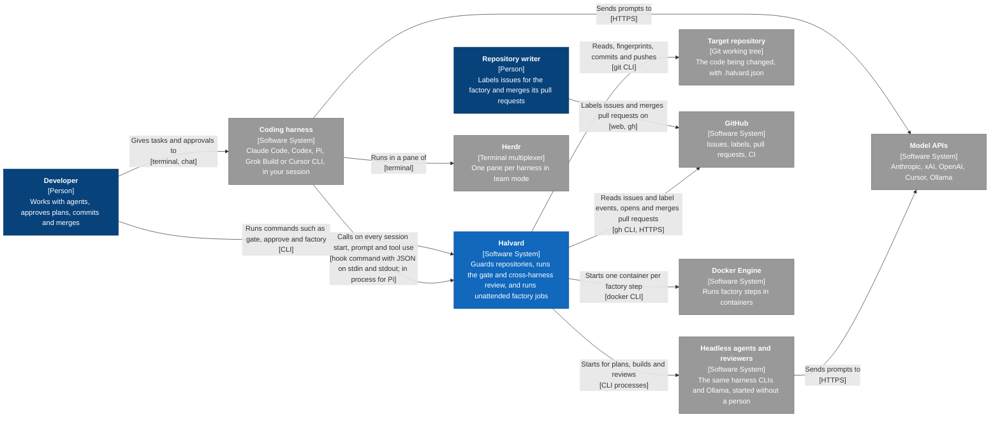
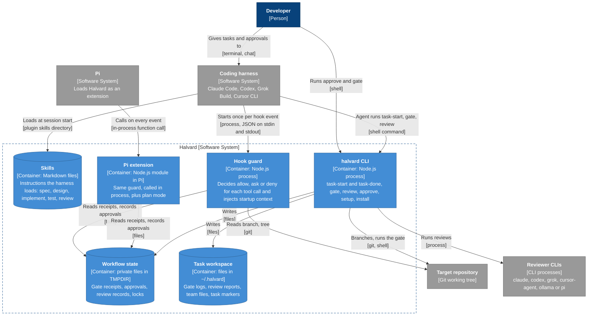
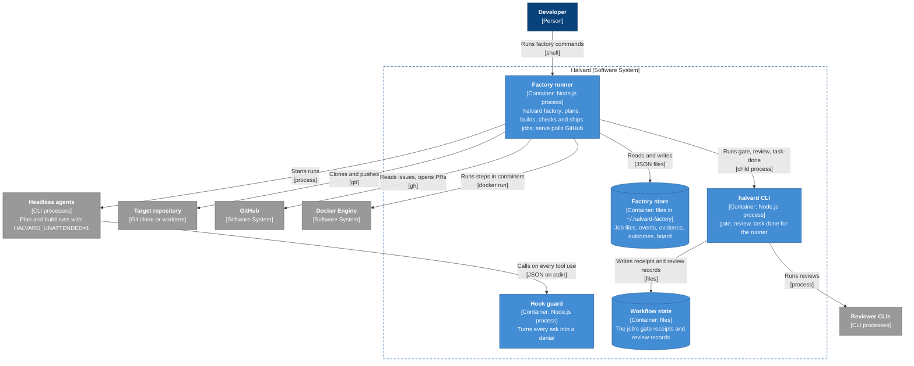
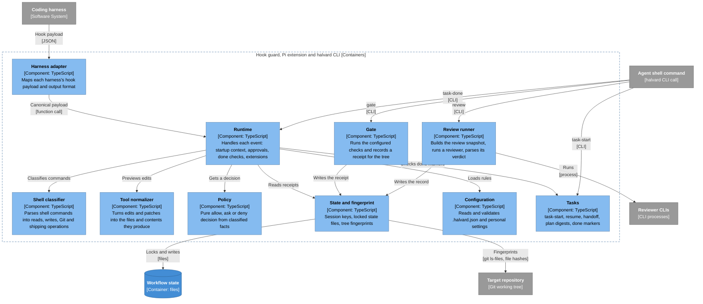
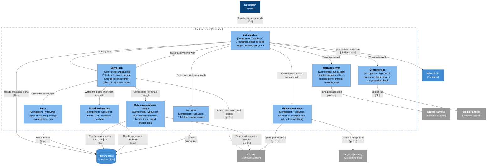
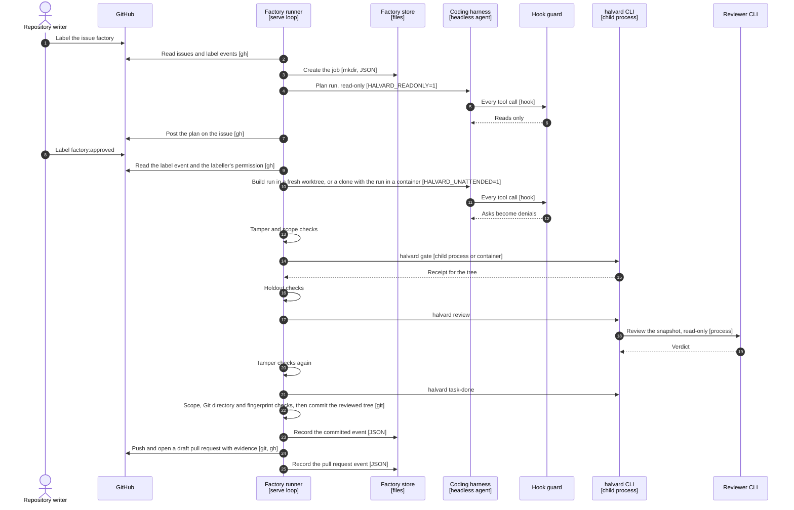
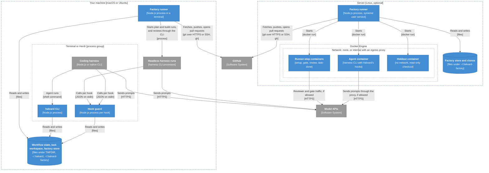

# Architecture

How Halvard is built, drawn with the [C4 model](https://c4model.com): a system context diagram, a container diagram, component diagrams for the two containers with real structure, a dynamic diagram of one factory job and a deployment diagram. There is no code-level diagram; the code is the source for that level. [Flow](flow.md) shows how to use Halvard; this page shows what runs where.

Every box names its type and technology, and every arrow says what it does and how. [Where things live](#where-things-live) maps each element to its files, so a change to the code shows which diagram to update.

## Key

| Shape | Meaning |
| --- | --- |
| Dark blue box | Person |
| Blue box | Halvard, or one of its containers |
| Light blue box | A component inside a Halvard container |
| Grey box | A system, store or process outside Halvard |
| Cylinder | A data store: files on disk |
| Dashed frame | The boundary of a system or container |
| Solid arrow | A one-way call, read or write, labelled with its purpose and technology |

## 1. System context

Halvard has no server of its own. It runs inside your coding harnesses, as their hooks and skills, and as a command you or an agent run in a terminal.

_Key: see [Key](#key)._ The developer and the repository writer are often the same person. Headless agents call Halvard's hooks too, like your own session. Halvard never calls a model API itself: harnesses do, for both authors and reviewers.

## 2. Containers

A C4 container is something that runs or stores data on its own. Halvard's processes are short-lived Node.js programs started by a harness or by you; its stores are plain files. The containers appear in two views: interactive use, and a factory run.

### Interactive use

_Key: see [Key](#key)._ The hook guard decides each call and records approvals and pending asks in workflow state. The agent runs the gate and the review itself with the CLI, and the guard checks their records when the agent marks the task done.

### Factory run

_Key: see [Key](#key)._ The CLI and the factory runner start from the same file, `bin/halvard.ts`, but they run as separate processes with different jobs and credentials, so they are drawn apart. In container mode the headless agents and the runner's CLI steps run inside Docker containers; [deployment](#5-deployment) shows where.

## 3. Components

### Guard and workflow engine

The hook guard, the Pi extension and the CLI share one engine in `core/`. A hook call passes through the adapter, the runtime and the classifiers to a pure policy decision.

_Key: see [Key](#key)._ Policy has no input or output of its own; the runtime gathers the facts and acts on the decision. `task-done` runs the runtime's own completion checks, the same ones a done edit gets. A done edit is allowed only when the gate receipt and the review record match the current tree fingerprint.

### Factory runner

_Key: see [Key](#key)._ The runner keeps Git and GitHub credentials to itself: agents, setup, the gate and the reviewer run with a scrubbed environment, an empty `gh` configuration and a push URL that cannot connect.

## 4. Dynamic: one factory job

A planned issue from intake to pull request. Numbers follow the order of the calls; a small job skips steps 4 to 9.

_Key: solid arrows are calls, dashed arrows are replies; the bracket names the technology._ Setup steps and the optional acceptance-test writer run between steps 9 and 10. A failed gate or a blocked review sends the job back to step 10 while fix passes remain; otherwise the job parks and the runner comments on the issue. Outcomes of the pull request are fetched later, by `factory serve` or `factory automerge`.

## 5. Deployment

The same code runs on your machine and on a server. Container mode adds one Docker container per factory step; without it, every step runs as you.

_Key: dashed frames are deployment nodes; boxes inside them are the containers deployed there._ On the server only the runner holds GitHub and SSH credentials. Every container gets the clone with a read-only `.git`, the extra mounts you configure and the variables you list (the model keys by default); no other host variable reaches it. Setup containers get nothing more. The others also get Halvard's own settings variables, such as `HALVARD_UNATTENDED`. Agent containers also get their prompt folder and, for a build, the task workspace. Holdout containers get the checkout, the extra mounts and the scenarios folder read-only, and a writable scratch folder. Gate, review and `task-done` containers also get the job's receipt folder, the task workspace and, read-only, your personal settings. [Factory](factory.md#containers) lists every mount.

## Where things live

| Element | Files |
| --- | --- |
| Hook guard | `bin/hook.ts`, `hooks/hooks.json` (Claude Code), `hooks/codex.json`, `hooks/grok.json`, `hooks/cursor.json` |
| Pi extension | `adapters/pi.ts`, `adapters/plan-ui.ts`, `adapters/plan-utils.ts` |
| halvard CLI | `bin/halvard.ts`, `core/cli.ts` |
| Factory runner | `core/factory*.ts`, started by `bin/halvard.ts factory` |
| Skills | `skills/*/SKILL.md`; the harness manifests in `.claude-plugin/`, `.codex-plugin/`, `.grok-plugin/` |
| Workflow state | `core/state.ts` (`$TMPDIR/halvard-<uid>/<repo digest>`) |
| Task workspace | `core/tasks.ts`, `core/flow-config.ts` (`HALVARD_WORKSPACE`, default `~/.halvard`) |
| Factory store | `core/factory-store.ts` (`HALVARD_FACTORY_HOME`, default `~/.halvard-factory`) |
| Harness adapter | `adapters/payload.ts`, `adapters/hooks.ts`, `adapters/messages.ts` |
| Runtime | `core/runtime.ts`, `core/context.ts`, `core/status.ts` |
| Shell classifier | `core/shell.ts` |
| Tool normalizer | `core/tools.ts` |
| Policy | `core/policy.ts` |
| State and fingerprint | `core/state.ts` |
| Configuration | `core/project.ts`, `core/flow-config.ts`, `core/types.ts` |
| Tasks | `core/tasks.ts`; `task-done` runs `completeTask` in `core/runtime.ts` |
| Gate | `runGate` in `core/runtime.ts` |
| Review runner | `core/review.ts` |
| Job pipeline | `core/factory.ts` |
| Serve loop | `core/factory-serve.ts` |
| Harness driver | `core/factory-harness.ts` |
| Container box | `core/factory-container.ts` |
| Job store | `core/factory-store.ts` |
| Ship and evidence | `core/factory-ship.ts` for the Git and `gh` helpers, changed files, risk and the pull request body; `ship()` in `core/factory.ts` uses them to commit, push and open the pull request |
| Outcomes and auto-merge | `core/factory-outcomes.ts` |
| Retro | `core/factory-retro.ts` |
| Board and metrics | `core/factory-board.ts` |

Not drawn, because they run only when you install or maintain Halvard: installation (`scripts/install.sh`, `core/install*.ts`, `core/personal-install.ts`), setup and bootstrap (`core/setup.ts`, `core/bootstrap.ts`, with the stack records in `stacks/`), history cleanup and retro events (`core/clean-history.ts`, `core/retro.ts`, which read harness transcripts), the Herdr team settings (`core/team.ts`) and `doctor` (`core/doctor.ts`, `core/package.ts`).

## Keeping it current

Update the diagram and the table in the same change when you add, remove or rename a container or component, or change how two of them talk. A new file inside an existing component needs only a table entry.
