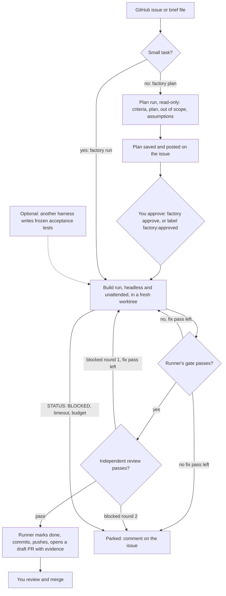

# Factory

Factory mode runs one task end to end without you at the keyboard. It is the third way to use Halvard, next to solo and team. A runner, which is plain code and not a model, starts a harness headless in its own worktree. The runner runs the gate and the cross-harness review itself, commits, pushes the branch and opens a pull request. You approve the plan for larger tasks, decide parked jobs and merge every pull request.

You can start jobs from your terminal, or let `factory serve` pick up labeled GitHub issues. Each job gets a worktree on your machine, or, with a `container` block, a clone whose agents, setup, gate and review run in containers.

## Flow



## Configure

Add a `factory` block to `.halvard.json`. Every key is optional:

```json
{
  "workflow": {"reviewers": {"grok": {}, "claude": {}, "cursor": {}}},
  "factory": {
    "author": "claude",
    "reviewers": ["grok", "cursor"],
    "setup": [["npm", "ci", "--omit=peer"]],
    "auth": {"claude": "subscription", "grok": "api"},
    "harnessArgs": {"grok": []},
    "timeouts": {"plan": 900, "build": 2700},
    "budgetUsd": 5,
    "maxFixPasses": 2,
    "draft": true,
    "riskPaths": ["deploy/**"],
    "monthlyUsd": 200,
    "pollSeconds": 300,
    "tests": {"by": "grok", "dir": "tests/acceptance"}
  }
}
```

| Key | Default | Effect |
| --- | --- | --- |
| `author` | `claude` | The harness that plans and builds. |
| `reviewers` | eligible reviewers in `workflow.reviewers` | Reviewer order for round 1. The first one whose CLI answers `--version` reviews. Round 2 always uses the round 1 reviewer, so a job parks if that reviewer stops answering. Keep these entries without a `reviewer` assignment, because an assignment allows only one reviewer. |
| `setup` | none | Commands run in the fresh worktree after the task branch exists, such as installing dependencies. |
| `auth` | `subscription` | Claude only: `api` runs `claude --bare --plugin-dir <halvard>` and needs `ANTHROPIC_API_KEY`; `subscription` runs a normal startup, which reads `CLAUDE_CODE_OAUTH_TOKEN` or your login and also loads your own Claude settings. Other harnesses use whatever credentials their CLI finds. |
| `harnessArgs` | none | Extra arguments per harness. |
| `timeouts` | 900 s plan, 2700 s build | Wall-clock limit per agent run, 60 to 14400 seconds. The runner sends SIGINT, then kills the process group 30 seconds later. |
| `budgetUsd` | 5 | Total agent spend per job. Claude gets the remainder as `--max-budget-usd`; other hosts report no cost, so only their timeouts apply. |
| `maxFixPasses` | 2 | Agent runs after the first build that fix a failed gate or a blocked review round 1, 0 to 3. |
| `draft` | true | Open the pull request as a draft. |
| `riskPaths` | CI and harness settings | Extra patterns that mark a pull request high risk. CI, `.halvard.json`, the harness settings directories, every `AGENTS.md` and `CLAUDE.md` and the retro's `paths` are always included. |
| `monthlyUsd` | 200 | Agent spend per calendar month (UTC), summed from the cost each agent run reports. Reviewer runs report no cost, so their spend is not counted. `factory serve` starts no new work, approved builds or retries once 90% of it is spent. |
| `pollSeconds` | 300 | How often `factory serve` checks GitHub, 60 to 3600 seconds. |
| `concurrency` | 1 | Jobs `factory serve` works at the same time, 1 to 4. Each starts only after a slot frees and the budget still allows it, so jobs already running can take the month a little past 90%. A pass waits for its jobs before the next poll, so a long job delays new issues and labels until it ends. |
| `container` | none | Run every step in containers; see [Containers](#containers). |
| `holdout` | none | Checks kept outside the repository; see [Holdout checks](#holdout-checks). |
| `autoMerge` | off | Change classes and the rules for merging without a person; see [Auto-merge](#auto-merge). |
| `retro` | none | A periodic job that turns recurring findings into guidance changes; see [Retro](#retro). |
| `tests` | none | Frozen acceptance tests. Before the build, the harness named in `by` writes tests for the task's acceptance criteria under `<dir>/<job>/` and nowhere else. The builder must make them pass and may not change them. It must be a different harness from `author`, and your gate must run the tests in that folder. Only that folder is frozen: the builder can still change the test runner's configuration or scripts, so add them to `riskPaths` and read them in the pull request. |

`gh` must be logged in on your machine for issues and pull requests. Without an `origin` remote, the runner builds from the local base branch and only commits.

## Commands

Run these from the repository's main checkout, in your own terminal. The guard denies them in agent sessions, and the runner refuses to start inside an agent run. The examples use a shell alias for the runner in your Halvard install or clone:

```sh
alias halvard='node /path/to/halvard/bin/halvard.ts'
halvard factory plan --issue 42                 # read-only plan run; the plan goes on the issue
halvard factory approve issue-42                # or add the label factory:approved to the issue
halvard factory build issue-42                  # build, gate, review, commit, push, draft PR
halvard factory run --issue 43                  # a small task: build without a plan stage
halvard factory run --brief task.md --title "Fix the parser" --id fix-parser --no-push
halvard factory build issue-42 --retry          # start a parked job again from its brief and plan
halvard factory stop issue-42                   # stop a job; a running one stops within seconds
halvard factory rework issue-42 --note note.md  # build a parked job again, with your note for the agent
halvard factory replan issue-42                 # plan again a job that has no approved plan
halvard factory serve                           # work labeled issues until Ctrl-C; --once for one pass
halvard factory ship issue-42                   # push a job built with --no-push and open its PR
halvard factory board                           # write the HTML board and job pages, and print the board's path
halvard factory metrics
halvard factory automerge                       # dry run: which pull requests would have merged by themselves
halvard factory retro --no-push                 # turn recurring findings into a guidance change now
halvard factory status [issue-42]
```

`--no-push` stops after the commit, which leaves the branch in the job's worktree. The main checkout is never switched or edited. `factory ship <job>` ships such a job later: it pushes the commit the runner recorded, by its id, and opens the pull request the way `build` would. It refuses when the branch no longer points at that commit, so nothing the gate and review did not cover goes out: move the branch back to the recorded commit to ship it, or push the branch yourself. A failed push or `gh` call leaves the job committed, and you can run `ship` again.

## Serve

`factory serve` runs in your terminal, or as a systemd user service or launchd agent, and works from GitHub labels. It needs no webhook and opens no port. Each pass:

1. Starts nothing while a job is parked for tampering or a job file does not read. It logs why and keeps polling, so fixing the cause is enough.
2. Parks jobs that wait for approval and whose issue is labeled `factory:stop`. A running job checks for that label before each step.
3. Builds again, or plans again, a parked job whose issue got `factory:retry` after it parked, or a job whose runner died mid-run.
4. Builds jobs whose plan got `factory:approved` after it was posted, and approved jobs that no runner is working on.
5. Merges open pull requests that qualify, when [auto-merge](#auto-merge) is on, and fetches what happened to the factory's other pull requests, at most hourly each.
6. Starts a [retro](#retro) job when one is due.
7. Claims new open issues labeled `factory`, `priority:high` first, then by number. `factory:small` skips the plan stage, and `bug` gives the branch the fix prefix.

Every label counts only if someone with write access to the repository added it; the runner reads the issue's label events and that person's permission. A triager's label does nothing. Steps 3, 4, 6 and 7 stop once 90% of `monthlyUsd` is spent this month. `serve` regenerates the board after every step. An issue that already has a job under any id is not claimed again. Ctrl-C or SIGTERM parks the current job as `stopped-by-human` and exits; a second Ctrl-C quits at once, even in the middle of the gate. While `serve` works a job, `factory approve` and `build` refuse to start, so approve with the label. `serve` also builds a job you approved with `factory approve`, and it always pushes and opens the pull request; stop `serve` first if you want `factory build --no-push` for that job.

| Label | Who adds it | Effect |
| --- | --- | --- |
| `factory` | you | The issue enters the factory |
| `factory:small` | you | Build without a plan stage |
| `priority:high` | you | Claimed before other issues |
| `factory:approved` | you | Approves the plan posted on the issue |
| `factory:stop` | you | Parks the job at its next step |
| `factory:retry` | you | Starts a parked job again |
| `factory:parked` | the runner | The job is parked; the comment says why |

## Containers

Without a `container` block the agent runs as you, on your machine. With one, each job gets a standalone clone, and every step that runs agent or repository code runs in a fresh container: the plan and build runs, the test writer, setup, the gate, the review and `task-done`.

```json
{
  "factory": {
    "container": {
      "image": "halvard-factory:0.0.1",
      "network": "factory-egress",
      "env": ["ANTHROPIC_API_KEY", "XAI_API_KEY", "HTTPS_PROXY", "HTTP_PROXY", "NO_PROXY"],
      "mounts": [],
      "runner": "/opt/halvard/bin/halvard.ts",
      "memory": "6g",
      "cpus": 2
    }
  }
}
```

| Key | Default | Effect |
| --- | --- | --- |
| `image` | required | The image every step runs in. |
| `network` | `none` | A Docker network. `none` gives no network at all; `host` is refused. |
| `env` | the model keys of the five harnesses | Host variables passed into the containers by name, even ones that look like credentials, because you listed them. Nothing else from your environment goes in. `PATH`, `HOME`, `TMPDIR` and `HALVARD_`, `GIT_`, `DOCKER_`, `GH_`, `GITHUB_` and `SSH_` names are refused, so GitHub and SSH credentials stay with the runner. |
| `mounts` | none | Extra bind mounts as `/host/path:/container/path[:ro]`, such as a harness login file for subscription auth. They reach every container, agents included, so a mount that overlaps the factory folder, the main checkout, the task workspace, your Halvard settings or `/var/run` is refused. A missing host path fails the step instead of being created. |
| `runner` | `/opt/halvard/bin/halvard.ts` | Halvard inside the image. Its version must equal the runner's, or the job parks before any agent runs. Every step of the job then runs the image by the id that passed this check, so rebuilding the tag mid-job changes nothing. |
| `memory`, `cpus` | none | Docker limits per container. |

Every container runs with `--cap-drop ALL`, `--security-opt no-new-privileges`, a process limit, your user and group id, and only these mounts, each at its host path so Git and Halvard see the same tree in both:

| Step | Mounts |
| --- | --- |
| Plan, build, test writer | The clone, the agent's prompt folder and the task workspace |
| Setup | The clone |
| Gate, review, `task-done` | The clone, the job's receipt folder, the task workspace, and your personal Halvard settings file read-only |

Every container gets the clone's `.git` folder read-only, and the runner checks it for links and special files before Git runs on the host, because Git writes through a link it finds there. For the same reason a job parks as tampered when the agent leaves a nested repository or a submodule outside the folders Git ignores: Git on the host would run that repository's fsmonitor and filters. Container mode therefore does not build repositories with submodules; a job whose base has one parks as `infra` before any agent runs.

The split matters. Your GitHub login, SSH keys, Git credentials and the rest of your home folder are never mounted, and the runner on the host does every fetch, push and `gh` call. The agent's containers never mount the receipt folder. Code the agent wrote does run in the gate's container, which mounts it, but the runner trusts each step's own exit status and output, never a receipt it finds lying there. A clone, unlike a worktree, has its own Git directory, so no container reaches your main checkout. The runner removes each container by name when its step ends, times out or is stopped, and removes every container still running when the runner exits, including on a second Ctrl-C. Docker failing to start a gate, for a missing image or a stopped daemon, parks the job as `infra` rather than counting as a failed gate.

Host and container compute the same tree fingerprint only if Git reads the same configuration on both sides, so in container mode the runner's fingerprint and the containers ignore your global and system Git configuration, a personal excludes file included. A file ignored only there counts as part of the tree; list build output in the project's `.gitignore`.

### The image

The image needs Node 22.18 or newer, Git, the harness CLIs you use, and Halvard at `runner`, registered with each harness and with hook trust approved. Approving hook trust is your decision; make it once, while you build the image. Containers run with your user id, so give the image a user with the same id and a home folder it owns:

```dockerfile
FROM node:22
ARG UID=1000
# A user with your id, whose home holds the harnesses' settings
RUN useradd --uid "$UID" --create-home factory 2>/dev/null || usermod --login factory --home /home/factory --move-home "$(id -nu "$UID")"
COPY halvard /opt/halvard
RUN npm install -g @anthropic-ai/claude-code @xai-official/grok
USER factory
# Register Halvard with each harness as docs/install.md describes, and approve hook trust.
```

Build it with the same Halvard version you run the factory from, for example `docker build --build-arg UID=$(id -u) -t halvard-factory:0.0.1 .`, and rebuild it when you update Halvard.

### Limiting the network

A step needs the network only for model APIs, the package registry during setup, and whatever your gate fetches. An internal Docker network has no route out; a proxy attached to it and to a normal network lets through only the hosts you list:

```sh
docker network create --internal factory-egress
docker run -d --name factory-proxy --network bridge <a forward proxy image with an allowlist>
docker network connect factory-egress factory-proxy
```

Allow the model API hosts of your harnesses and your package registry. Pass `HTTPS_PROXY` and `HTTP_PROXY` pointing at the proxy through `env`. A request the proxy refuses fails the step that made it, which parks the job with that step's output.

## Board and metrics

`factory board` writes `~/.halvard-factory/<repo>/board.html`: one static page, no script, that your browser reloads every 30 seconds. It shows every job by stage, its reviewer and round, cost, pull request and why it parked, under a row of numbers. `plan`, `approve`, `build`, `run`, `rework`, `replan`, `stop`, `retro` and `ship` write it when they finish, and `serve` after every step. A job's id on its card links to the job's own page, `jobs/<job>/job.html`, with its state, the timeline of agent runs, gates and review findings, the brief, the plan, the evidence and the last lines of each log. All job text shows as escaped text. `factory metrics` prints the same numbers as JSON:

| Number | Meaning |
| --- | --- |
| `firstGatePassRate` | Jobs whose first runner gate passed, in percent |
| `firstReviewBlockRate` | Jobs whose round 1 review blocked, in percent |
| `parkRate` | Jobs that are parked, in percent |
| `parked` | Parked jobs by reason |
| `meanCostPerFinishedUsd` | Mean agent cost of committed and pull-request jobs |
| `medianHoursToCommit` | Median time from job creation to the runner's commit |
| `monthSpendUsd` | Agent spend this calendar month |
| `mergedPullRequests` | Factory pull requests merged so far |
| `humanEditRate` | Merged factory pull requests a person edited, in percent: a commit on the pull request that the factory did not make, or a commit to the same files on the base within 14 days of the merge, other than a factory merge |
| `humanEditRateByClass` | The same per [change class](#auto-merge), with merged, edited and reverted counts |

The pull request numbers come from what `factory serve` or `factory automerge` last fetched, so `metrics` and the board never call GitHub.

## Holdout checks

A holdout check is a command whose scenarios live outside the repository, where the builder cannot read or weaken them. The runner runs each one after the gate passes and before the review, in the job's checkout:

```json
"holdout": [
  {"name": "scenarios", "dir": "/srv/factory/scenarios", "command": ["/srv/factory/scenarios/run.sh"]},
  {"name": "mutation", "dir": "/srv/factory/mutation", "command": ["/srv/factory/mutation/run.sh"], "sample": 0.2, "blocking": false}
]
```

| Key | Default | Effect |
| --- | --- | --- |
| `name` | required | A short lowercase name, used in the evidence and the log. |
| `dir` | required | An absolute host folder with the scenarios. It may not overlap the repository, the factory's folders, your settings or a container mount. |
| `command` | required | The command, run in the checkout with `HALVARD_HOLDOUT_DIR` set to `dir`, `HALVARD_FACTORY_BASE` to the base commit and `TMPDIR` to a scratch folder. It gets the environment without credentials that setup gets; in container mode only those three variables reach it, not the container's `env` list. |
| `sample` | 1 | The share of jobs it runs on. The job id decides, so a retry runs the same checks. The choice is predictable from the id, so sampling saves cost; it hides nothing. |
| `blocking` | true | A failed blocking check parks the job as `holdout-failed`; any other result goes into the pull request evidence. |

The check's output goes to `holdout.log` in the job folder, never to an agent: a failed check parks the job instead of starting a fix pass, because a fix pass would show the builder what the scenarios test. A check may write only to `$TMPDIR`; one that changes the checkout parks the job as `infra`, because the gate and review cover that tree. In container mode the check runs in its own container with no network, the checkout, `dir` and the container's extra `mounts` read-only and only the scratch folder writable, so a check that writes to the checkout fails there and parks the job as `holdout-failed`. Code the builder wrote therefore cannot copy the scenarios where a later fix pass would find them; the agent's container never mounts `dir`. Without containers the agent runs as you and could read the folder, so the scenarios are hidden from its prompt and tree, not from a determined agent.

Sampled checks suit expensive runs such as mutation testing of the changed lines: `HALVARD_FACTORY_BASE` lets the command find them. The engine knows no test tool; the command is yours.

## Auto-merge

A change class is a set of path patterns. When the runner commits, it records the class whose patterns match every changed file, the task file aside, with the number of changed lines and whether the gate and review passed the first time. The evidence shows them.

```json
"autoMerge": {
  "enabled": false,
  "classes": {"docs": ["docs/**"], "tests": ["tests/**"]},
  "requiredChecks": ["build", "test"],
  "minPrs": 30,
  "minCleanRate": 95,
  "maxLines": 200,
  "windowDays": 30
}
```

A pull request merges without a person only when all of these hold:

- Its files fit a class, it touches no risk path, and it changes at most `maxLines` lines. A moved file counts at its old and its new path. List dependency manifests and lockfiles in `riskPaths`, so a new dependency always reaches a person.
- The gate and the review passed the first time, with no fix pass, and no holdout check failed.
- Its CI is green: every check succeeded, every name in `requiredChecks` is among them, and it has at least one.
- It is not a draft, and its head is still the factory's commit.
- No person objected: no requested changes, no review other than an approval, and no `factory:stop` label on the pull request or its issue.
- It is not a retro job. Guidance changes always reach a person.
- The class has at least `minPrs` factory pull requests that a person merged at least 14 days earlier, at least `minCleanRate` percent of those with no human edits, and no revert in the last `windowDays` days. A revert is a commit on the base whose message says `This reverts commit <merge commit>`. Pull requests that auto-merge merged itself do not count, so the rule never vouches for itself.

`factory automerge` is the dry run. It fetches every factory pull request and prints which merged ones would have qualified at the moment they merged, which open ones qualify now, and the human-edit rate per class. It merges nothing.

Merging needs container mode, because without it the agent runs as you and could change what the runner recorded, a nonempty `requiredChecks`, `"enabled": true` and the repository variable `FACTORY_AUTOMERGE` set to `on`; anything else, including a failed lookup, merges nothing, so `gh variable set FACTORY_AUTOMERGE --body off` stops it at once. `factory serve` then merges a qualifying pull request with `gh pr merge --squash --match-head-commit <factory commit>`, so a push after the check stops the merge. It records an `auto-merge` event; a merge GitHub refuses is tried again an hour later, not on every poll. `requiredChecks` match by name, and a workflow in the pull request itself can post a status under any name, so also protect the base branch with required checks pinned to the app that runs them. Check a sample of merged pull requests by hand each month.

## Retro

```json
"retro": {"everyDays": 7, "paths": ["AGENTS.md", "skills/**"]}
```

A retro reads what went wrong since the last one: every review finding, every failed runner gate and every job that parked for a reason other than your stop. When that came from at least two jobs, it creates the job `retro-<date>`, a small job whose brief carries those records as untrusted data. The builder looks for problems that recur in at least two jobs and changes the repository's guidance to prevent them; it may change only files that match `paths`, and a change to anything else parks the job as `out-of-scope`. The change goes through the gate and review and opens a pull request like any other job.

`factory serve` starts a retro once `everyDays` days have passed since the last one. `factory retro` starts one now; `--since <days>` sets how far back it reads.

## What keeps an unattended run safe

- **No approvals.** The runner sets `HALVARD_UNATTENDED=1` for the agent. Every guard ask becomes a denial that tells the agent the runner ships, and chat approvals are refused. So commit, push, publish and edits to workflow settings never run through the guard, whatever the harness does with an ask headless.
- **Read-only planning.** The plan run also gets `HALVARD_READONLY=1`, which makes the guard allow only reads in every harness.
- **Nothing outside the worktree.** In both runs the guard denies file edits outside the worktree and the task workspace. That covers the main checkout, the shared Git directory and the factory's job files. In a plan run it also denies shell redirects there.
- **No credentials in the agent's environment.** Agents, setup commands, the gate and the reviewer run without `GH_TOKEN`, `GITHUB_TOKEN`, an SSH agent or any other variable that looks like a token, secret, password or cloud credential. Model API keys stay, because the harness needs them. Git gets an empty credential helper and a push URL that cannot connect, and `gh` gets an empty configuration directory. A gate that needs a secret in its environment does not get one.
- **The runner checks before it trusts the tree.** After setup and after each agent run, the runner parks the job if any Git configuration it reads changed, in any scope, or your personal Halvard settings changed. It also parks the job if the branch changed `.halvard.json`, harness settings, extensions, or the gate's or review's scripts. The runner's own Git commands skip repository hooks and fsmonitor, and push to the URL it read before any agent ran.
- **The runner's own receipts.** The runner runs `halvard gate` with its own session key and records the review against that receipt. It marks the task done with `halvard task-done`, which applies the hook's completion checks. It also compares the approved plan with the digest the runner itself holds, not the one in the task file. The commit holds exactly the reviewed tree plus the status line, and the agent's process group is killed before the runner commits.
- **Approvals bound to the plan.** Posting a plan removes any old `factory:approved` label. The label then counts only while it is on the issue and only if someone with write access to the repository added it after the plan was posted. While a job's runner is alive, `factory approve`, `plan`, `build` and `run` refuse to start.
- **Same limits as solo.** A blocked review gets one re-review with the same reviewer. A second block parks the job for you.

- **Tests the builder did not write.** With `tests` set, another harness writes the acceptance tests first, inside their folder only. The runner records a digest of them and parks the job if they change.

### What a run without containers does not protect against

Without a `container` block, the agent runs as you, with a shell, on your machine. The guard and the runner's checks catch mistakes and an agent that follows a misleading instruction. They are not a boundary against an agent that sets out to do harm. Such an agent could read your `gh` login, `~/.git-credentials` or SSH keys from disk, rewrite your other branches through Git, or edit job files with a shell command. Run the factory only on repositories and issues whose authors you trust, and use each harness's own sandbox where it has one, or use containers. In container mode the agent still holds the model keys you pass in, and it can reach whatever the container's network allows.

Before you use Grok as the author, run the headless probes from the factory research: whether a Grok hook decision holds headless, and with `--always-approve`, is not yet verified. Add `--always-approve` to `harnessArgs.grok` only after those probes pass.

## Files

| Path | Holds |
| --- | --- |
| `~/.halvard-factory/<repo>/jobs/<job>/job.json` | The job's state, written only by the runner |
| `…/events.jsonl` | One line per step: agent runs with cost and time, gate, review, commit, PR |
| `…/brief.md`, `…/plan.md` | The brief and the plan as proposed and approved |
| `…/agent.log`, `…/runner.log`, `…/setup.log` | Agent output, gate and review output, setup output |
| `…/evidence.md`, `…/evidence.json` | The pull request body and the receipts behind it |
| `…/holdout.log` | Output of the holdout checks |
| `…/outcome.json` | What happened to the pull request: state, CI, human commits, later commits to its files, a revert |
| `…/stop`, `…/rework-<time>.md` | A stop request from `factory stop`, and your rework notes |
| `…/state` | Container mode: the gate and review receipts, which only runner steps mount |
| `…/job.html` | The job's page, written with the board |
| `~/.halvard-factory/<repo>/worktrees/<repo>-<job>` | The job's worktree, or its clone in container mode, on its task branch |
| `~/.halvard-factory/<repo>/board.html` | The board |

`HALVARD_FACTORY_HOME` moves the whole folder. Team files and review summaries stay in the task workspace, `~/.halvard/<repo>-<job>/<job>/`.

## Parked jobs

`factory plan`, `build` and `run` exit with status 3 when the job parks, so a script can tell it from a shipped one. A job parks when the agent reports `STATUS: BLOCKED`, a run times out or spends the budget, the gate still fails with no fix pass left, the review blocks round 2, the reviewer stops answering, the branch conflicts with the base, the runner finds tampering, a blocking holdout check fails, a retro job changes files outside its paths, you stop the runner with Ctrl-C, or setup or `gh` fails. The runner records the reason in `job.json`, comments on the issue and adds the `factory:parked` label. The worktree stays for you to inspect. `factory build <job> --retry`, `factory rework <job> --note <file>` or the `factory:retry` label removes that worktree and the job's own branch and builds again from the same brief and approved plan. It also restarts a job left mid-build by a runner that died. A job that parked before its plan was approved, or whose plan run died, gets `factory replan <job>`. After a job parks for tampering, or while a job file does not read, no factory command starts work until you have checked your Git configuration, personal settings and the job file: then run `factory build <job> --retry --checked`, or delete the job's folder. `factory status` never fails on a parked job.
