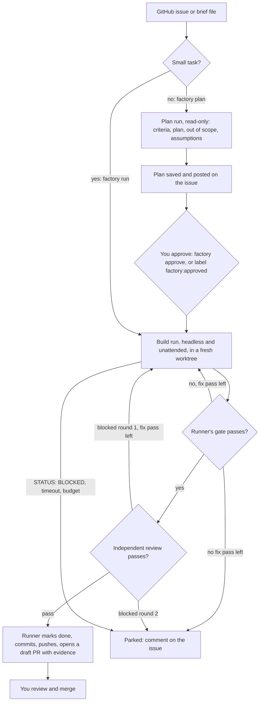

# Factory

Factory mode runs one task end to end without you at the keyboard. It is the third way to use Halvard, next to solo and team. A runner, which is plain code and not a model, starts a harness headless in its own worktree. The runner runs the gate and the cross-harness review itself, commits, pushes the branch and opens a pull request. You approve the plan for larger tasks, decide parked jobs and merge every pull request.

This is phase 1: one job at a time, started from your terminal, in a worktree on your machine. There is no daemon, queue or container yet.

## Flow



## Configure

Add a `factory` block to `.halvard.json`. Every key is optional:

```json
{
  "workflow": {"reviewers": {"grok": {}, "claude": {}, "cursor": {}}},
  "factory": {
    "author": "claude",
    "reviewers": ["grok", "cursor"],
    "setup": [["npm", "ci", "--omit=peer"]],
    "auth": {"claude": "subscription", "grok": "api"},
    "harnessArgs": {"grok": []},
    "timeouts": {"plan": 900, "build": 2700},
    "budgetUsd": 5,
    "maxFixPasses": 2,
    "draft": true,
    "riskPaths": ["deploy/**"]
  }
}
```

| Key | Default | Effect |
| --- | --- | --- |
| `author` | `claude` | The harness that plans and builds. |
| `reviewers` | eligible reviewers in `workflow.reviewers` | Reviewer order for round 1. The first one whose CLI answers `--version` reviews. Round 2 always uses the round 1 reviewer, so a job parks if that reviewer stops answering. Keep these entries without a `reviewer` assignment, because an assignment allows only one reviewer. |
| `setup` | none | Commands run in the fresh worktree after the task branch exists, such as installing dependencies. |
| `auth` | `subscription` | Claude only: `api` runs `claude --bare --plugin-dir <halvard>` and needs `ANTHROPIC_API_KEY`; `subscription` runs a normal startup, which reads `CLAUDE_CODE_OAUTH_TOKEN` or your login and also loads your own Claude settings. Other harnesses use whatever credentials their CLI finds. |
| `harnessArgs` | none | Extra arguments per harness. |
| `timeouts` | 900 s plan, 2700 s build | Wall-clock limit per agent run, 60 to 14400 seconds. The runner sends SIGINT, then kills the process group 30 seconds later. |
| `budgetUsd` | 5 | Total agent spend per job. Claude gets the remainder as `--max-budget-usd`; other hosts report no cost, so only their timeouts apply. |
| `maxFixPasses` | 2 | Agent runs after the first build that fix a failed gate or a blocked review round 1, 0 to 3. |
| `draft` | true | Open the pull request as a draft. |
| `riskPaths` | CI and harness settings | Extra patterns that mark a pull request high risk. CI, `.halvard.json` and the harness settings directories are always included. |

`gh` must be logged in on your machine for issues and pull requests. Without an `origin` remote, the runner builds from the local base branch and only commits.

## Commands

Run these from the repository's main checkout, in your own terminal. The guard denies them in agent sessions, and the runner refuses to start inside an agent run. The examples use a shell alias for the runner in your Halvard install or clone:

```sh
alias halvard='node /path/to/halvard/bin/halvard.ts'
halvard factory plan --issue 42                 # read-only plan run; the plan goes on the issue
halvard factory approve issue-42                # or add the label factory:approved to the issue
halvard factory build issue-42                  # build, gate, review, commit, push, draft PR
halvard factory run --issue 43                  # a small task: build without a plan stage
halvard factory run --brief task.md --title "Fix the parser" --id fix-parser --no-push
halvard factory build issue-42 --retry          # start a parked job again from its brief and plan
halvard factory status [issue-42]
```

`--no-push` stops after the commit, which leaves the branch in the job's worktree. The main checkout is never switched or edited.

## What keeps an unattended run safe

- **No approvals.** The runner sets `HALVARD_UNATTENDED=1` for the agent. Every guard ask becomes a denial that tells the agent the runner ships, and chat approvals are refused. So commit, push, publish and edits to workflow settings never run through the guard, whatever the harness does with an ask headless.
- **Read-only planning.** The plan run also gets `HALVARD_READONLY=1`, which makes the guard allow only reads in every harness.
- **Nothing outside the worktree.** In both runs the guard denies file edits outside the worktree and the task workspace. That covers the main checkout, the shared Git directory and the factory's job files. In a plan run it also denies shell redirects there.
- **No credentials in the agent's environment.** Agents, setup commands, the gate and the reviewer run without `GH_TOKEN`, `GITHUB_TOKEN`, an SSH agent or any other variable that looks like a token, secret, password or cloud credential. Model API keys stay, because the harness needs them. Git gets an empty credential helper and a push URL that cannot connect, and `gh` gets an empty configuration directory. A gate that needs a secret in its environment does not get one.
- **The runner checks before it trusts the tree.** After setup and after each agent run, the runner parks the job if any Git configuration it reads changed, in any scope, or your personal Halvard settings changed. It also parks the job if the branch changed `.halvard.json`, harness settings, extensions, or the gate's or review's scripts. The runner's own Git commands skip repository hooks and fsmonitor, and push to the URL it read before any agent ran.
- **The runner's own receipts.** The runner runs `halvard gate` with its own session key and records the review against that receipt. It marks the task done with `halvard task-done`, which applies the hook's completion checks. It also compares the approved plan with the digest the runner itself holds, not the one in the task file. The commit holds exactly the reviewed tree plus the status line, and the agent's process group is killed before the runner commits.
- **Approvals bound to the plan.** Posting a plan removes any old `factory:approved` label. The label then counts only while it is on the issue and only if someone with write access to the repository added it after the plan was posted. While a job's runner is alive, `factory approve`, `plan`, `build` and `run` refuse to start.
- **Same limits as solo.** A blocked review gets one re-review with the same reviewer. A second block parks the job for you.

### What phase 1 does not protect against

In phase 1 the agent runs as you, with a shell, on your machine. The guard and the runner's checks catch mistakes and an agent that follows a misleading instruction. They are not a boundary against an agent that sets out to do harm. Such an agent could read your `gh` login, `~/.git-credentials` or SSH keys from disk, rewrite your other branches through Git, or edit job files with a shell command. Run the factory only on repositories and issues whose authors you trust, and use each harness's own sandbox where it has one. Containers with only model credentials come in a later phase.

Before you use Grok as the author, run the headless probes from the factory research: whether a Grok hook decision holds headless, and with `--always-approve`, is not yet verified. Add `--always-approve` to `harnessArgs.grok` only after those probes pass.

## Files

| Path | Holds |
| --- | --- |
| `~/.halvard-factory/<repo>/jobs/<job>/job.json` | The job's state, written only by the runner |
| `…/events.jsonl` | One line per step: agent runs with cost and time, gate, review, commit, PR |
| `…/brief.md`, `…/plan.md` | The brief and the plan as proposed and approved |
| `…/agent.log`, `…/runner.log`, `…/setup.log` | Agent output, gate and review output, setup output |
| `…/evidence.md`, `…/evidence.json` | The pull request body and the receipts behind it |
| `~/.halvard-factory/<repo>/worktrees/<job>` | The job's worktree on its task branch |

`HALVARD_FACTORY_HOME` moves the whole folder. Team files and review summaries stay in the task workspace, `~/.halvard/<job>/<job>/`.

## Parked jobs

`factory plan`, `build` and `run` exit with status 3 when the job parks, so a script can tell it from a shipped one. A job parks when the agent reports `STATUS: BLOCKED`, a run times out or spends the budget, the gate still fails with no fix pass left, the review blocks round 2, the reviewer stops answering, the branch conflicts with the base, the runner finds tampering, you stop the runner with Ctrl-C, or setup or `gh` fails. The runner records the reason in `job.json`, comments on the issue and adds the `factory:parked` label. The worktree stays for you to inspect. `factory build <job> --retry` removes that worktree and the job's own branch and builds again from the same brief and approved plan. It also restarts a job left mid-build by a runner that died. After a job parks for tampering, no factory command starts work until you have checked your Git configuration and personal settings: then run `factory build <job> --retry --checked`, or delete the job's folder. `factory status` never fails on a parked job.
