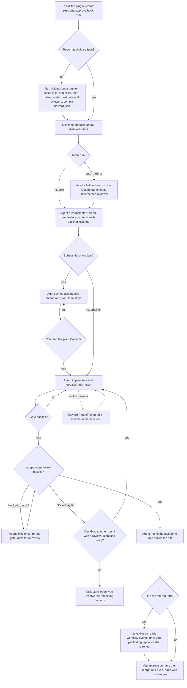
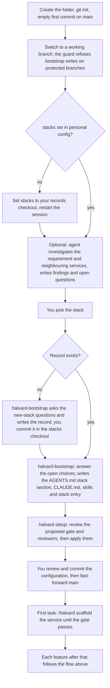
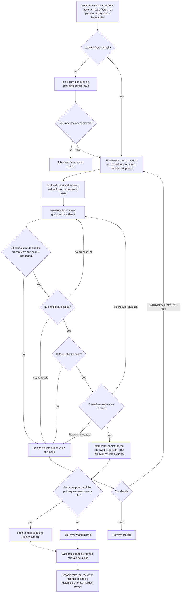

# Flow

How to use Halvard, from install to merge, by hand or through the [factory](#factory). VS Code draws the diagrams in the Markdown preview with the Markdown Preview Mermaid Support extension; GitHub draws them as is.

## New service

Starting a service from an empty folder adds steps before the flow above. Bootstrap and setup write configuration only, so the gate cannot pass until the first task scaffolds the service.

The empty first commit matters: in a repository without commits, `setup` proposes the current branch as base.

## Factory

Factory mode runs the same flow without you at the keyboard: a runner on your machine or a server drives a headless harness, runs the gate and the review itself, and ships a pull request. You stay at three points: approving plans, merging, and deciding parked jobs. See [Factory](factory.md) for setup and every command.

