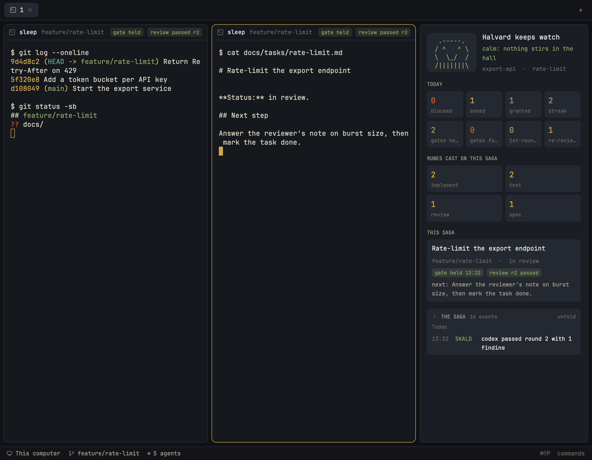

# Halvard

A dark, warm-amber window for working with coding agents under the Halvard workflow. Spaces and agents sit on the left, tabs and framed terminal panes in the middle, and a watchtower panel on the right narrates the focused repository's Halvard run log: a mascot whose face follows the guard, today's scoreboard, the skills loaded on the task, a card for the branch's task and a folding feed of events. Every pane wears a header with its team role, its agent status and its branch's latest gate and review. A button on the watchtower opens a "hall" tab with one pane per harness of the repository's team.

## What you see

Left to right. A 248px sidebar on `chrome` (`#121418`): a 46px brand block (shipped `workspace-chrome`, draggable), the shipped `spaces` and `agents` lists sharing the height equally (each at least 90px), and a 69px footer (`workspace-chrome` with `footer: true`). A 1px `border` (`#2a2e36`) divider follows.

The work column: a 42px tab bar (shipped `tabs`, draggable), a body with 8px padding and 8px gaps, and a 28px status bar (shipped `workspace-status`). The body holds the active tab's panes, each with a 10px radius, a 1px border that turns `accent` (`#d4a84b`) on focus, and an always-shown 32px header. A hidden 368px files/changes panel (shipped `files` and `changes`, stacked) sits to their right, and the 340px watchtower on `surface` (`#1a1d23`) with a 10px radius and a 1px border closes the row (280px to 640px).

The watchtower, top to bottom, with 14px padding and 14px gaps:

- A mascot: a four-line ASCII face in JetBrains Mono 13px on a `raised` (`#242830`) tile, beside "Halvard keeps watch" (14px semibold), its mood line (12px, in the mood's color) and "repository · task" (11.5px, dim). Calm is `^ ^` with a smile in `done` green (`#8fa86a`); watchful is `- o` with a flat mouth in amber; alarmed is `O O` with `!!!` in `blocked` red (`#d0603f`), pulsing its opacity from 0.45 to 1 every 900ms.
- TODAY: eight tiles in two rows of four, each a 16px semibold number over a 10.5px dim label: blocked, asked, granted, streak, then gates held, gates fell, 1st-round pass, re-reviews.
- RUNES CAST ON THIS SAGA (or RUNES CAST TODAY when the branch has no task file): one tile per skill, two to a row, its count over its name without the `halvard-` prefix, most loaded first; a muted line when none.
- THIS SAGA: a card with the task's title (13px semibold, two lines at most), "branch · status", chips for the latest gate ("gate held 13:22") and review ("review r2 passed"), or dim "no gate yet" and "no review yet", and "next: …" from the task's Next step.
- THE SAGA: a folded block showing the event count ("16 events", or "last 20 events") and the newest line under its day; opened, every line under Today, Yesterday or "Thu 12 Nov" headers. Each line is a 40px mono time, a 46px colored tag (ENTER, BLOCK, ASK, WORD, GATE, SKALD, RUNE, SAGA, HAND, DONE) and the text, clipped to two lines.
- "Summon the hall": a full-width amber button, shown only when the repository's `.halvard.json` holds a valid team.

A pane header, left to right: the role chip when the summon opened the pane (JARL for lead, SMITH for dev, SKALD for reviewer, SEER for investigator, in amber), the program's icon and name, the branch (dim, truncated), "gate held" or "gate fell" and "review passed r2" or "review blocked r1" chips, and the agent's status. Chips are 18px high, 10.5px semibold, in their color over the same color at 15% alpha.

The theme `halvard` sets the terminal palette: background `#15181d`, foreground `#ddd5c3`, cursor `#d4a84b`, selection `#3a3426`, and a muted earth-tone ANSI set (red `#d0603f`, green `#8fa86a`, yellow `#d4a84b`, blue `#6b8fb3`, magenta `#a98bb8`, cyan `#6fa8a0`).

## How it behaves

Agent statuses in a pane header: working shows a spinning 12px spinner in `working` blue (`#6b8fb3`, one turn per 900ms); blocked shows a red "Needs you" chip; done shows a 7px green dot; idle shows nothing.

Hovering a header reveals four 14px buttons: split right, split down, zoom (unzoom when zoomed) and close, running `pane.split`, `pane.zoom` and `pane.close` on that pane. A click elsewhere on the header focuses the pane.

The watchtower follows focus. When a terminal in another repository takes focus, the panel switches to that repository's log; until the switch finishes it shows no task card and no summon button, so it never pairs one repository's task with another. A mod pane keeps the last repository. Outside a Git repository it says "Focus a terminal inside a Git repository to watch its Halvard run log."; for a space on another machine it says the run log is this computer's; for a repository with no log yet it shows "No run log yet for this repository."

The mood is alarmed after a denial, a failed gate or a blocked review in the last 10 minutes; watchful while an approval request from the last 10 minutes has no outcome; calm otherwise. The scoreboard counts today; the streak counts consecutive passing gates.

New events appear within a few seconds of Halvard writing them. Clicking the closed saga opens it in place of the task card; clicking its header folds it again. Hovering a saga line shows its full text; hovering the task card shows its next step, or its title when it has none.

"Summon the hall" opens a tab named `hall` in the repository: the lead's harness on the left, the dev's to its right, the reviewer's under the dev and, when the team has one, the investigator's right of the reviewer. While it runs the button reads "Summoning the hall…" and ignores clicks. If Herdr does not open every pane, a red line under the button says so.

## Built from

`layouts/halvard.json`: a root `row` with `theme: "halvard"`, `titlebar: "none"`, traffic lights at `[12, 16]`, `terminal_padding: [14, 12]` and a 1px `border` divider. Its children are the `sidebar` column (blocks `brand`, `sidebar-lists` with `spaces` and `agents`, `sidebar-footer`) and the `work` column (blocks `tabs`, `work-body`, `status`). `work-body` is a row of `main` (content `tab: "active"`, pane gap 8, radius 10, `lone: true`, header `{ content: { mod: "halvard-session" }, height: 32, position: "top", reveal: "always" }`), the hidden `panel` column with a `stack` of `files` and `changes`, and the `watchtower` block with content `{ mod: "halvard-watch" }`. `layouts/halvard.svg` is the layout picker's preview.

`mods/halvard-watch` (`mod.json`: `place: "none"`): `main.js` draws the panel; `log.js` parses and summarizes the run log; `task.js` finds the branch's task file; `summon.js` reads the team and opens the hall. It uses `exec`, `focused`, `panes`, `readTextFile`, `run`, `setShared`, `shared`, `spaces`, `theme` and `watchFolder` from `herdr`, and `readdir` from `fs/promises`. It runs `sh` (to read `$HALVARD_DATA` and to resolve a folder's repository with `git rev-parse --show-toplevel` and `pwd -P`) and `ls -t` (to order task files). Commands: `tab.new`, `pane.focus` and `terminal.open`.

The run log is Halvard's: `${HALVARD_DATA:-~/.halvard}/logs/<repo>/events.jsonl` and `<repo>/<task>/events.jsonl`, one JSON object per line with `at`, `kind`, `harness`, `branch`, `task` and the kind's fields. A `.repo` file in each folder names the repository's real path, which decides the folder when two repositories share a name. Task files live in the repository's `workflow.taskDirectory` from `.halvard.json` (default `docs/tasks`), each with a `<!-- halvard {...,"branch":"..."} -->` line; the newest file naming the branch wins. The team is `.halvard.json`'s `team` (`lead`, `dev`, `reviewer`, optional `investigator`, each one of `pi`, `claude`, `codex`, `grok`, `cursor`).

`mods/halvard-session` (`mod.json`: `place: "none"`): the pane header. It reads props `{ pane, terminal }`, uses `panes`, `props`, `run`, `shared` and `theme`, and draws the shipped icons `mods/pane/split-right.svg`, `split-down.svg`, `zoom.svg`, `unzoom.svg`, `close.svg` and `mods/workspace-chrome/spinner.svg`.

The mods talk through shared state, so only the watchtower reads the log: `halvard.status` maps each repository root to its branches' latest `{ gate, review }`; `halvard.repos` maps each pane folder to its repository root; `halvard.roles` maps pane ids to `lead`, `dev`, `reviewer` or `investigator`.

`themes/halvard.json`: the colors above plus `canvas` `#0f1115`, `popover` `#1f232a`, `hover` `#242830`, `selected` `#2c3039`, `input` `#3a3f49`, `muted` `#a69f90`, `dim` `#6f6a60`, `idle` `#6f6a60`, `solid` `#d4a84b`, and `accent_foreground` and `solid_foreground` `#15181d`.

## Watch out

The watchtower reads files outside its folder (the Halvard data folder, each repository's `.halvard.json` and task files) and runs `sh`, `git` and `ls`. The summon starts coding agents.

`run()` returns nothing, and a new pane reaches `panes()` only on a later frame, so the summon records the panes before each step and waits up to 3 seconds for a new one in the hall's tab. `pane.split` takes no `argv`, so each split focuses its neighbour and uses `terminal.open` with a `place`. Cursor's terminal agent runs as `cursor-agent`; the other harnesses run under their own names.

Focus is live data and `render` runs on every change, but resolving a folder's repository needs `git`, so render starts a lookup only for a new folder and a 2-second timer retries a repository whose log folder is missing. A lookup that finds nothing new must not call `cx.notify()`, or render and lookup feed each other. The timer also rereads `.halvard.json` and the task file every 10 seconds, because they change without a log event.

Branch and skill names are data: keep them out of plain object keys or check own properties, or a branch called `__proto__` reaches `Object.prototype`. Read whole log files: the streak, the tallies and each branch's latest verdict need the full history. Keep a newline between files, so a torn last line cannot swallow the next file's first event.

Plain text collapses spaces, so the mascot's art uses no-break spaces. The panel counts skill events only; Halvard writes them when a tool call loads a skill. A remote space shows the quiet message, because the log is local.

## Done when

- `herdr-app check` passes for `mods/halvard-watch` and `mods/halvard-session`, and `layout.switch {name: "halvard"}` shows the layout with no errors in `herdr-app status`.
- Focusing a terminal in a repository with a Halvard run log shows its mascot, scoreboard, runes and saga; appending a line to its `events.jsonl` updates the panel within a few seconds.
- A `deny` event within 10 minutes turns the mascot alarmed; an `ask` without an `outcome` turns it watchful; neither, calm.
- A task file naming the focused branch shows its card; a branch without one shows none.
- Each pane header in that repository shows the branch's latest gate and review chips, including panes in repositories not focused since they opened.
- With a valid `team` in `.halvard.json`, "Summon the hall" opens a `hall` tab with the panes in the positions above, each running its harness, and their headers show JARL, SMITH, SKALD and SEER.
